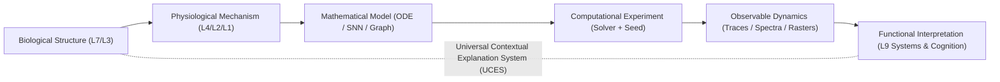

# CORTEXIA

**Comprehensive Neuroscience & Computational Brain Systems Platform**  
*Explore the Brain. Decode Its Dynamics. Model Its Intelligence.*

---

> [!IMPORTANT]
> **Phase 0 Repository Notice:** This repository currently contains the **Phase 0 Scientific, Product & Software Specification Package** for CORTEXIA. Application source code (`React`, `TypeScript`, `Three.js`, Web Workers, WASM kernels) is intentionally deferred to implementation Phases A–H. No live deployment or clinical validation is claimed in Phase 0.

---

## 1. Platform Vision

**CORTEXIA** is an integrated computational neuroscience research, simulation, and educational exploration environment designed to examine the nervous system simultaneously as:

1. **A Biological Organ** — hierarchical anatomical organization across cortical, subcortical, brainstem, cerebellar, spinal, and peripheral systems.
2. **An Electrochemical System** — membrane biophysics, ionic gradients, voltage- and ligand-gated channels, and neurotransmitter dynamics.
3. **A Distributed Network** — local cortical/subcortical microcircuits, long-range white-matter pathways, and structural vs. functional connectomics.
4. **A Computational System** — quantitative ODE, PDE, stochastic, spiking-network, plasticity, and neural-mass models with reproducible numerical solvers.
5. **A Cognitive System** — multi-region distributed networks mediating perception, memory, attention, decision-making, language, and executive control.

Every scientific element inside CORTEXIA connects along a continuous exploratory spine:



---

## 2. Core Architectural Pillars

| Pillar | Scope | Authoritative Specification |
|---|---|---|
| **9 Biological Scales (`L1`–`L9`)** | Molecular → Subcellular → Cellular → Synaptic → Microcircuit → Mesoscopic → Brain Regions → Whole-Brain Networks → Systems & Cognition | [NEUROSCIENCE_SCOPE_AND_SCALES.md](docs/02-scientific-foundation/NEUROSCIENCE_SCOPE_AND_SCALES.md) |
| **12 Primary Modules (`M01`–`M12`)** | Observatory, Neuroanatomy, Cellular, Molecular, Synaptic Plasticity, Circuits/Connectomics, Neurophysiology, Comp-Neuro Lab, Systems, Cognitive, Signal Analytics, Knowledge Library | [MODULES_OVERVIEW_SPECIFICATION.md](docs/01-product/MODULES_OVERVIEW_SPECIFICATION.md) |
| **5 Integrated Work Environments** | Explore, Laboratory, Analytics, Knowledge, Research | [PRODUCT_ARCHITECTURE.md](docs/01-product/PRODUCT_ARCHITECTURE.md) |
| **4 3D Visualization Studios** | Whole Brain Studio, Cellular Studio, Synaptic & Molecular Studio, Neural Network Studio | [STUDIO_SPECIFICATIONS.md](docs/09-visualization/STUDIO_SPECIFICATIONS.md) |
| **Universal Contextual Explanation System (UCES)** | Hover tooltip + Click/Selection Inspector + Dedicated Knowledge Page across all 17+ scientific UI entity classes | [UNIVERSAL_EXPLANATION_SYSTEM.md](docs/09-visualization/UNIVERSAL_EXPLANATION_SYSTEM.md) |
| **5-Tier Educational Brain Digital Twin** | Anatomically anchored cross-scale experiments with explicit abstraction & validity boundaries | [DIGITAL_TWIN_ARCHITECTURE.md](docs/02-scientific-foundation/DIGITAL_TWIN_ARCHITECTURE.md) |
| **Scientific Knowledge Graph & 22 JSON Schemas** | Typed multi-scale entity relationships + strict runtime/static schema contracts | [KNOWLEDGE_GRAPH_SPECIFICATION.md](docs/10-knowledge-architecture/KNOWLEDGE_GRAPH_SPECIFICATION.md) |

---

## 3. Repository Structure

```text
CORTEXIA/
├── README.md                          # Platform & Phase 0 index
├── .gitignore                         # OS, editor, build, cache, and secret exclusions
├── docs/
│   ├── 00-governance/                 # Charter, documentation standards, glossary, ADRs
│   ├── 01-product/                    # Vision, PRD, product/IA architecture, user journeys, modules
│   ├── 02-scientific-foundation/      # 9 biological scales, 12 research domains, 5-tier digital twin
│   ├── 03-neuroanatomy/               # Module 02 specification, TNA nomenclature, atlas provenance
│   ├── 04-cellular-and-molecular/     # Modules 03 & 04: neurons, glia, ion channels, neurochemistry
│   ├── 05-neurophysiology/            # Modules 05 & 07: electrophysiology, synapses, STDP, plasticity
│   ├── 06-computational-models/       # Module 08: 16 model families, 28 models, equations, solvers, QA
│   ├── 07-systems-and-cognition/      # Modules 06, 09 & 10: circuits, connectomics, systems, cognition
│   ├── 08-neural-data-and-analytics/  # Module 11: FFT, STFT, wavelets, spikes, graph metrics, stats
│   ├── 09-visualization/              # Three.js engine, 4 3D studios, asset specs, UCES architecture
│   ├── 10-knowledge-architecture/     # Module 12: typed knowledge graph & encyclopedia architecture
│   ├── 11-data-and-research/          # 10-registry data architecture, dataset licenses, reproducibility
│   ├── 12-software-architecture/      # System, frontend, Web Worker, performance, error, security specs
│   ├── 13-ui-ux/                      # Design system, layout, all 12 module UX specs, accessibility
│   ├── 14-quality-and-validation/     # Test strategy, scientific/numerical QA, benchmarks, traceability
│   ├── 15-deployment/                 # Vite build, GitHub Pages SPA routing, CI/CD release pipelines
│   └── 16-project-management/         # 8-phase roadmap (A-H), WBS, risks, progress, completion report
├── schemas/                           # 22 JSON Schema Draft 2020-12 contracts + valid/invalid examples
├── registries/                        # Structured scientific registries (anatomy, models, equations, refs...)
├── tools/documentation-audit/         # Automated validation, schema, link, UCES & consistency auditor
└── reports/                           # Generated audit & implementation-readiness reports
```

---

## 4. Scientific Boundaries & Non-Clinical Disclaimer

CORTEXIA is strictly an **educational and computational research exploration environment**. It does **not** perform or claim:

- Clinical diagnosis, prognosis, or treatment recommendations for neurological or psychiatric disorders.
- Medical-grade EEG/MRI interpretation or individual mind-reading/decoding.
- Full biological replication of the human brain or real-time whole-human-brain simulation in the browser.
- Equivalence between procedural/illustrative 3D geometry and patient-derived medical imaging reconstructions.

Every computational model declares its governing equations, physical units, solver tolerances, assumptions, validity domain, and reference benchmarks.

---

## 5. Running Automated Phase 0 Audits

The Phase 0 audit suite validates Markdown inventory, internal relative links, JSON syntax, all 22 JSON Schemas (against registries and positive/negative fixtures), cross-registry referential integrity, duplicate IDs, model/equation/reference coverage, UCES coverage, and requirements traceability:

```bash
python3 tools/documentation-audit/run_audit.py
```

Outputs are written to `reports/documentation-audit/audit-report.json` and `reports/documentation-audit/audit-report.md`. See [tools/documentation-audit/README.md](tools/documentation-audit/README.md) for rule definitions and exit codes.
