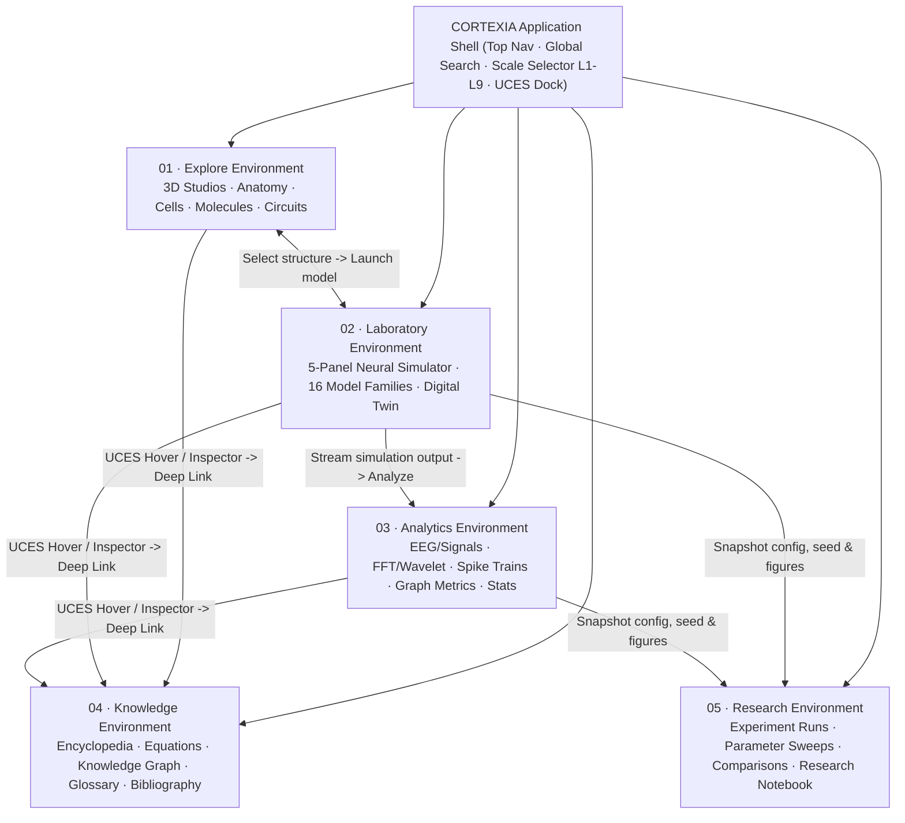

# Product Architecture — CORTEXIA

**Document ID:** `DOC-PROD-003`  
**Status:** Authoritative (Phase 0)  
**Last Updated:** 2026-11-16

---

## 1. Purpose and Scope

This document defines how CORTEXIA's **5 Work Environments** integrate the **12 Scientific Modules**, **4 3D Visualization Studios**, **9 Biological Scales**, **Knowledge Graph**, and **Universal Contextual Explanation System (UCES)** into one coherent application architecture rather than twelve disconnected pages.

## 2. Five Work Environments Overview

### 2.1 Environment Responsibilities & Module Mapping

| Environment | ID | Primary Focus | Integrated Modules | Primary 3D / Visual Engines |
|---|---|---|---|---|
| **Explore** | `ENV-01` | Multi-scale biological & anatomical inspection | `MOD-01`, `MOD-02`, `MOD-03`, `MOD-04`, `MOD-05`, `MOD-06`, `MOD-09`, `MOD-10` | Studios A, B, C, D + Pathway SVG maps |
| **Laboratory** | `ENV-02` | Mathematical modeling, hypothesis testing & Digital Twin | `MOD-08`, `MOD-05`, `MOD-07` | Simulation-linked 3D playback + live plots |
| **Analytics** | `ENV-03` | Signal processing, spike analysis, graph metrics & statistics | `MOD-11`, `MOD-06` | Multichannel traces, PSD, spectrograms, matrices |
| **Knowledge** | `ENV-04` | Authoritative encyclopedia, equations, KG & references | `MOD-12`, `MOD-01`–`MOD-11` | Interactive KG graph, KaTeX equations, validation cards |
| **Research** | `ENV-05` | Experiment presets, sweeps, run comparison & notebooks | `MOD-08`, `MOD-11`, `MOD-12` | Diff plots, sweep heatmaps, reproducibility manifests |

## 3. Cross-Environment State & Context Handover

To ensure seamless `Anatomy → Physiology → Computation → Function` navigation:
1. **Shared Selection Bus (Zustand `selectionStore`):** Clicking `ANAT-HIPPOCAMPUS-CA1` in Explore keeps its entity context available when switching to Laboratory, automatically suggesting `MODEL-LIF-CA1-NETWORK` or `MODEL-PAIR-STDP` and filtering related Knowledge entries.
2. **Simulation-to-Analytics Pipe:** Every completed simulation run writes an immutable typed `ExperimentResult` payload into the session store. Clicking **"Open in Analytics"** routes directly to `ENV-03` pre-loaded with voltage traces, spike trains, or connectivity matrices tagged with synthetic-simulation provenance.
3. **UCES Universal Overlay:** Regardless of active Environment (`ENV-01`–`ENV-05`), the right-hand **UCES Contextual Inspector** operates as a persistent, non-destructive drawer synchronizing with whatever entity the user selects.

## 4. Multi-Scale Integration Spine (`L1`–`L9`)

- **Scale Switcher:** Persistent scale breadcrumb (`L1 Molecular` … `L9 Systems & Cognition`) allows users anchored on a parent concept (e.g., `ANAT-HIPPOCAMPUS` at `L7`) to step up to `CIRC-DEFAULT-MODE-NET` (`L8`) / `COG-EPISODIC-MEMORY` (`L9`) or down to `CIRC-HIPP-TRISYNAPTIC` (`L5`), `CELL-PYRAMIDAL-CA1` (`L3`), `MECH-LTP-NMDA` (`L4`), and `MOL-NMDAR-GLUN1` (`L1`).
- **Abstraction Boundary Banner:** Whenever traversing across scales where mechanistic emergence is abstracted rather than explicitly simulated, the UI renders an explicit badge explaining the scale bridge assumptions.

## 5. Assumptions, Dependencies & Acceptance Criteria

- **Assumptions:** All 12 modules share a single client-side Knowledge Graph index and normalized entity ID registry.
- **AC-PROD-003:** Users can traverse from any anatomical entity in `ENV-01` to a coupled simulator in `ENV-02`, inspect signal metrics in `ENV-03`, inspect full mathematical theory in `ENV-04`, and archive the run in `ENV-05` in <= 4 clicks without losing entity selection state.

## 6. Related Documents

- [PRODUCT_REQUIREMENTS.md](PRODUCT_REQUIREMENTS.md)
- [INFORMATION_ARCHITECTURE.md](INFORMATION_ARCHITECTURE.md)
- [USER_JOURNEYS.md](USER_JOURNEYS.md)
- [APPLICATION_LAYOUT_AND_ENVIRONMENTS.md](../13-ui-ux/APPLICATION_LAYOUT_AND_ENVIRONMENTS.md)
