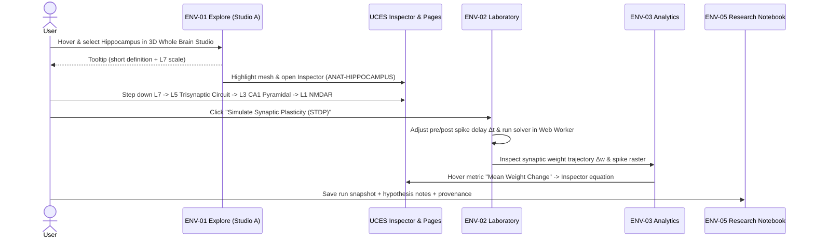

# User Journeys — CORTEXIA

**Document ID:** `DOC-PROD-004`  
**Status:** Authoritative (Phase 0)  
**Last Updated:** 2026-11-16

---

## 1. Purpose and Scope

This document specifies end-to-end user journeys demonstrating how learners, researchers, and educators traverse CORTEXIA across modules, 3D studios, computational simulators, signal analytics, and the Universal Contextual Explanation System (UCES).

## 2. Journey 1 — Flagship Scientific Spine (`Anatomy → Physiology → Computation → Function`)

**Persona:** Undergraduate/Graduate Neuroscience Student  
**Objective:** Understand how hippocampal CA1 NMDA receptors and STDP contribute to associative memory circuits.

1. **Select Brain Structure (`ENV-01`, Studio A):** User hovers over the Hippocampus; tooltip displays canonical name (`Hippocampus`), short definition, and `L7` badge. Clicking isolates the limbic structure and opens the UCES Inspector.
2. **Explore Biological Architecture (`L7 → L5 → L3 → L1`):** Using cross-scale links inside the Inspector, user transitions to Studio B (`CELL-PYRAMIDAL-CA1`) and Studio C (`MECH-LTP-NMDA` / `MOL-NMDAR`). Each click updates 3D focus and inspector equations.
3. **Run Computational Experiment (`ENV-02`):** User clicks **"Launch Associated Model: Pair-Based STDP"** (`MODEL-STDP-PAIR`), inspects the governing equations, modifies $\Delta t$ and $A_+/A_-$, and runs the Web Worker simulation.
4. **Analyze Dynamics (`ENV-03`):** User transfers run outputs to Analytics to plot synaptic weight evolution $\Delta w(\Delta t)$ and firing statistics.
5. **Connect to Cognitive Systems & Archive (`ENV-04` / `ENV-05`):** User opens the `COG-EPISODIC-MEMORY` page to review distributed hippocampal–neocortical consolidation limits and archives the reproducible run manifest in Research Notebook.

## 3. Journey 2 — Universal Contextual Explanation System (UCES) Discovery

**Persona:** Self-Directed Learner inspecting an unfamiliar simulator (`MODEL-HODGKIN-HUXLEY`).
1. **Hover:** Pointer pauses on the `g_Na_max` slider (`120 mS/cm²`). Tooltip shows *"Maximum Sodium Conductance (`g_Na_max`, `120 mS/cm²`): Peak permeability of voltage-gated $Na^+$ channels driving action potential upstroke. Click label to inspect."*
2. **Click Inspector:** Clicking the parameter badge opens the UCES Inspector showing biophysical meaning, Squid Giant Axon provenance (`REF-HH-1952`), valid parameter range, sensitivity note (threshold & peak voltage), and linked equation `EQ-HH-INA`.
3. **Dedicated Knowledge Page:** Clicking **"Open Full Parameter & Channel Reference"** navigates to `/knowledge/MOL-VGSC-SODIUM` for complete gating kinetics ($\alpha_m, \beta_m, \alpha_h, \beta_h$), mammalian channel isoforms ($Na_v1.1$–$Na_v1.6$), and limitations.

## 4. Journey 3 — Computational Parameter Sweep & Model Comparison

**Persona:** Computational Neuroscientist comparing spiking vs. conductance excitability (`EXP-HH-FI-CURVE` vs. `EXP-ADEX-FIRING-REGIMES`).
1. User selects `MODEL-HODGKIN-HUXLEY` in `ENV-02`, switches setup mode to **Parameter Sweep**, and sweeps `I_ext` from `0` to `25 µA/cm²` in `1 µA/cm²` steps using RK4 (`dt = 0.01 ms`).
2. Worker streams progress (`0% → 100%`) and renders the $f\text{–}I$ firing-rate curve alongside Type II Hopf-like onset discontinuity.
3. User runs an analogous current sweep on `MODEL-ADEX` (`EXP-ADEX-FIRING-REGIMES`), loads both snapshots into `ENV-05` Research Comparison view, exports JSON/CSV data + reproducibility manifest, and verifies solver convergence (`dt = 0.01 ms` vs `0.005 ms`).

## 5. Journey 4 — Experimental EEG & Neural Signal Analytics (`MOD-11`)

**Persona:** Biomedical / Cognitive Neuroscience Student analyzing public EEG / synthetic benchmark traces.
1. User opens `ENV-03` Analytics and loads bundled sample dataset `DSET-SYNTH-ALPHA-EEG` (explicitly marked `SYNTHETIC_ILLUSTRATIVE`) or imports a local multi-channel CSV (`<= 50 MB` client-side).
2. Dataset Inspector verifies sampling rate (`fs = 256 Hz`), channel labels (`O1`, `O2`, `Cz`, `Fz`), physical units (`µV`), and licensing/provenance banner.
3. User applies `0.5–45 Hz` bandpass Butterworth filter, runs Welch PSD (`4 s` Hann window, `50%` overlap), inspects Morlet time-frequency spectrogram, and hovers over the `8–12 Hz` alpha peak. UCES links to `ANAT-OCCIPITAL-CORTEX` and `MECH-THALAMOCORTICAL-ALPHA`, noting that sensor-level power reflects macroscopic synchronous postsynaptic potentials (`REF-BUZSAKI-2012`), not single-neuron firing.

## 6. Journey 5 — Educational Digital Twin Cross-Scale Perturbation (`Tier 5`)

**Persona:** Course Instructor demonstrating how cellular excitability modulation alters microcircuit synchrony.
1. User opens Integrated Digital Twin Experiment A (`EXP-TWIN-EXCITABILITY-TO-CIRCUIT`) in `ENV-02`.
2. Step 1 increases neuronal leak conductance / lowers threshold excitability; Step 2 updates conductance-based AMPA/GABA synapses; Step 3 simulates a 400-neuron E/I microcircuit (`80% E / 20% I`); Step 4 passes population spike rasters to Analytics to compare baseline vs. intervention PSD and synchrony index.
3. Explicit Tier-5 assumption card reminds the audience which links are coupled numerically and which anatomical context is conceptual.

## 7. Acceptance Criteria

- **AC-PROD-004:** All five journeys execute cleanly through documented routes, stores, and UI affordances without dead ends or unmapped entity references.

## 8. Related Documents

- [PRODUCT_ARCHITECTURE.md](PRODUCT_ARCHITECTURE.md)
- [INFORMATION_ARCHITECTURE.md](INFORMATION_ARCHITECTURE.md)
- [MODULE_UX_SPECIFICATIONS.md](../13-ui-ux/MODULE_UX_SPECIFICATIONS.md)
