# Educational Brain Systems Digital Twin Architecture — CORTEXIA

**Document ID:** `DOC-SCI-003`  
**Status:** Authoritative (Phase 0)  
**Last Updated:** 2026-11-16

---

## 1. Document Purpose and Scope

This specification defines CORTEXIA's **Five-Tier Educational Brain Systems Digital Twin**, establishing formal multi-scale coupling contracts, spatial/temporal scale bounds, computational envelopes, provenance tracking, validation boundaries, and **three fully specified integrated multi-scale experiments**.

> [!WARNING]
> **Terminology Safeguard:** In CORTEXIA, "Digital Twin" strictly denotes an **educational and computational multi-scale integration model** of selected neural mechanisms and network motifs. CORTEXIA does NOT simulate a complete, individualized, or biologically faithful replica of the human brain.

## 2. Five-Tier Architecture

| Tier | Architectural Layer | Core Artifacts & Models | Scales | Coupling Mechanism |
|---|---|---|---|---|
| **Tier 1** | Anatomical Digital Representation | Whole Brain Atlas (`MOD-02`, Studio A), TNA hierarchy, region parcellations | `L6`–`L7` | Spatial coordinates + KG `PART_OF` / `ANATOMICAL_CONNECTION` |
| **Tier 2** | Physiological Components | Single-neuron (`HH`, `AdEx`, `Izhikevich`) + Synaptic kernels (`AMPA`, `NMDA`, `GABA_A`, `STP`) | `L1`–`L4` | Conductance $g_{\text{syn}}(t)$ & spike-event emission |
| **Tier 3** | Circuit-Level Models | Microcircuits (`E/I` balanced spiking networks, cortical motif, trisynaptic circuit) | `L5` | Directed adjacency matrix $W_{ij}$ + axonal delays $\tau_d$ |
| **Tier 4** | Network-Level Models | Multi-region coupled neural masses (`Wilson–Cowan`, `Jansen–Rit`, `Kuramoto`) on structural connectome | `L6`, `L8` | Inter-regional coupling matrix $C_{ab}$ + tract delays |
| **Tier 5** | Integrated Brain System Experiments | Coupled pipeline orchestrating Tier 1 context + Tiers 2–4 numerical chaining + `MOD-11` Analytics | `L1`–`L9` | Typed `PipelineStageContract` + explicit abstraction bridge |

---

## 3. Cross-Scale Coupling & Interface Contracts

```mermaid
flowchart LR
  S1["Stage 1: Cellular Parameter Perturbation (e.g. g_L or I_ext or Tau_m)"] -->|"Spike Train / Excitability Gain"| S2["Stage 2: Synaptic Kernel & Plasticity (g_AMPA, g_GABA, STDP Δw)"]
  S2 -->|"E/I Conductance Matrix W(t)"| S3["Stage 3: Microcircuit / Network Solver (N=400 Spiking or 12-Region Mass)"]
  S3 -->|"Population Rates, LFP Proxy, Spike Rasters"| S4["Stage 4: Analytics Runtime (PSD, Synchrony, Graph Modularity)"]
  S4 -->|"Baseline vs Intervention Delta"| S5["Stage 5: Educational Functional Context (Scoped Interpretation)"]
```

### 3.1 Mechanistic vs. Conceptual Coupling Distinction
Every Digital Twin experiment MUST declare in its schema (`digitalTwinCouplingMode`) which bridges are **Mechanistic** (exact mathematical output passed as input to the next ODE/SNN stage) vs. **Conceptual** (anatomical localization or cognitive interpretation linked via Knowledge Graph):
- **Mechanistic Links:** Ion channel perturbation → single-cell f–I curve; spike train → synaptic conductance; synaptic weights → E/I network raster; population voltage proxy → Welch PSD / PLV.
- **Conceptual / Contextual Links:** Mapping a 400-neuron spiking E/I motif onto `ANAT-HIPPOCAMPUS-CA1` or interpreting gamma synchrony shifts in terms of `COG-WORKING-MEMORY`.

### 3.2 Browser Compute Envelopes (Safety Guardrails)
- **Single-Run Neuron Cap (Biophysical HH):** `<= 200` coupled neurons; `dt <= 0.02 ms`; duration `<= 2,000 ms`.
- **Single-Run Neuron Cap (AdEx / LIF / Izhikevich SNN):** `<= 4,000` neurons, `<= 200,000` synapses; `dt = 0.1 ms`; duration `<= 5,000 ms`.
- **Whole-Brain Mass Network (Tier 4):** `<= 90` parcellated regions (e.g., Desikan–Killiany 68 cortical + subcortical anchors); `dt = 0.5 ms`; duration `<= 30,000 ms`.

---

## 4. Three Detailed Integrated Experiment Specifications

### Integrated Experiment A (`EXP-TWIN-EXCITABILITY-TO-CIRCUIT`)
**Title:** *Neuronal Excitability Perturbation → Synaptic Response → Microcircuit Synchrony*
- **Anatomical Anchor (Tier 1 — Conceptual):** `ANAT-PREFRONTAL-CORTEX` Layer 2/3 canonical E/I microcircuit.
- **Stage 1 (`MODEL-ADEX`, Tier 2 — Mechanistic):** User adjusts pyramidal adaptation conductance $a$ or leak conductance $g_L$ (representing biophysical excitability modulation). Simulator measures single-cell rheobase and $f\text{–}I$ slope.
- **Stage 2 (`MODEL-SYN-EXP`, Tier 2 — Mechanistic):** Pyramidal $f\text{–}I$ parameterization updates $800$ excitatory and $200$ fast-spiking inhibitory cells (`MODEL-LIF-EI-NETWORK`, Tier 3) coupled with AMPA ($\tau = 5\text{ ms}$) and $GABA_A$ ($\tau = 10\text{ ms}$) exponential conductances.
- **Stage 3 (`MOD-11` Analytics — Mechanistic):** Compute mean firing rate ($\text{Hz}$), coefficient of variation of ISI ($CV_{\text{ISI}}$), pairwise spike synchrony, and LFP-proxy Welch PSD (`20–80 Hz` gamma band power).
- **Stage 4 (Output & Comparison):** Side-by-side baseline vs. perturbed raster plot, firing-rate histogram, and spectral shift report.
- **Validation Boundary:** Demonstrates E/I balance sensitivity (`REF-BRUNEL-2000`, `REF-VOGELS-2011`); explicitly disclaims clinical psychiatric diagnosis.

### Integrated Experiment B (`EXP-TWIN-PLASTICITY-TO-DYNAMICS`)
**Title:** *Pair-Based STDP Plasticity → Directed Weight Reorganization → Population Dynamics*
- **Anatomical Anchor (Tier 1 — Conceptual):** `ANAT-HIPPOCAMPUS-CA3` recurrent associative assembly (`CIRC-HIPP-TRISYNAPTIC`).
- **Stage 1 (`MODEL-STDP-PAIR`, Tier 2 — Mechanistic):** Configure STDP potentiation/depression amplitudes ($A_+, A_-$) and time constants ($\tau_+, \tau_-$) using `REF-BI-POO-1998` asymmetry.
- **Stage 2 (`MODEL-SNN-STDP-ASSEMBLY`, Tier 3 — Mechanistic):** Train a `500`-neuron sparse recurrent LIF network with patterned cue stimulation (`3` overlapping sensory subgroups) over `10 s` simulated training followed by `2 s` recall probe.
- **Stage 3 (`MOD-11` Network & Spike Analytics — Mechanistic):** Inspect evolution of synaptic weight matrix $W(t)$, directed degree centrality, clustering coefficient, and cue-triggered population recall reactivation.
- **Validation Boundary:** Verifies bounded weight stability (`[0, w_max]`) and homeostatic scaling necessity (`REF-TURRIGIANO-2008`); conceptualizes pattern completion without claiming biological episodic memory fidelity.

### Integrated Experiment C (`EXP-TWIN-CONNECTOME-OSCILLATIONS`)
**Title:** *Macroscopic Network Coupling → Coupled Neural Oscillations → Spectral & Functional Connectivity Analytics*
- **Anatomical Anchor (Tier 1 & 4 — Atlas Anchored):** `68`-region synthetic/benchmark cortical structural graph based on Desikan–Killiany parcellation labels (`REF-DESIKAN-2006`).
- **Stage 1 (`MODEL-KURAMOTO-CONNECTOME` or `MODEL-WILSON-COWAN-NET`, Tier 4 — Mechanistic):** Set global coupling gain $G$, conduction velocity $v$ ($\text{m/s}$) yielding delay matrix $\tau_{ij} = d_{ij}/v$, and intrinsic regional frequency ($10\text{ Hz}$ alpha / $40\text{ Hz}$ gamma).
- **Stage 2 (Simulation View):** Render 3D Whole Brain Studio node phase/activity waves alongside regional time series.
- **Stage 3 (`MOD-11` Signal & Graph Analytics — Mechanistic):** Compute Kuramoto order parameter $R(t)$, band-pass filtered envelopes, pairwise Phase-Locking Value (PLV) functional connectivity matrix, and correlation between empirical-benchmark SC and simulated FC (`REF-BREAKSPEAR-2017`, `REF-SANZ-LEON-2013`).
- **Validation Boundary:** Illustrates how fixed anatomical topology constrains dynamic FC states while reiterating that synthetic simulated FC is not an individual fMRI/EEG scan.

## 5. Assumptions, Dependencies & Acceptance Criteria

- **Dependencies:** [MODEL_CATALOG.md](../06-computational-models/MODEL_CATALOG.md), [SIGNAL_ANALYTICS.md](../08-neural-data-and-analytics/SIGNAL_ANALYTICS.md), [PERFORMANCE_ARCHITECTURE.md](../12-software-architecture/PERFORMANCE_ARCHITECTURE.md).
- **AC-SCI-003:** Each Digital Twin experiment executes reproducibly within browser memory/compute budgets (`<= 256 MB` worker heap), labels mechanistic vs. conceptual steps unambiguously, and logs complete reproducibility manifests.

## 6. References

- `REF-SANZ-LEON-2013`: Sanz-Leon et al. (2013), *Frontiers in Neuroinformatics*, DOI: `10.3389/fninf.2013.00010`.
- `REF-BREAKSPEAR-2017`: Breakspear (2017), *Nature Neuroscience*, DOI: `10.1038/nn.4497`.
- `REF-BRUNEL-2000`: Brunel (2000), *J. Comput. Neurosci.*, DOI: `10.1023/A:1008925309027`.
- `REF-BI-POO-1998`: Bi & Poo (1998), *J. Neurosci.*, DOI: `10.1523/JNEUROSCI.18-24-10464.1998`.
