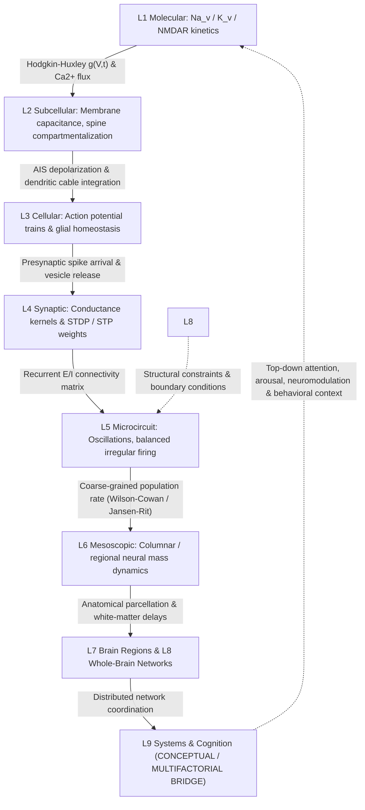

# Neuroscience Scope and Nine Biological Scales — CORTEXIA

**Document ID:** `DOC-SCI-001`  
**Status:** Authoritative (Phase 0)  
**Last Updated:** 2026-11-16

---

## 1. Document Purpose

This specification defines CORTEXIA's scientific domain taxonomy and **Nine-Scale Neuroscience Architecture (`L1`–`L9`)**, specifying spatial/temporal regimes, covered biological entities, cross-scale coupling mechanisms, and mandatory epistemic abstraction boundaries.

## 2. Scope

Covers the biological continuum from molecular ion channels and receptors (`L1`) through macroscopic systems and cognitive networks (`L9`), governing entity classification across `MOD-01`–`MOD-12`, the Knowledge Graph, and the Multi-Scale Navigation UI.

## 3. Terminology

- **Emergence:** System-level behavior (e.g., macroscopic EEG alpha rhythm or working-memory persistence) arising from interactions of many lower-scale elements that cannot be trivially read off a single ion channel or cell.
- **Coarse-Graining / Mean-Field Abstraction:** Mathematical compression of microscopic population variables (e.g., thousands of spiking neurons) into low-dimensional macroscopic state variables (e.g., Wilson–Cowan firing rates $E(t), I(t)$).
- **Non-Deterministic Scale Boundary:** A cross-scale interface where lower-scale observations constrain—but do not uniquely determine—higher-scale functional states without intermediate boundary conditions, neuromodulatory context, or stochastic dynamics.

---

## 4. Detailed Specification of the Nine Biological Scales (`L1`–`L9`)

| Scale ID | Scale Name | Typical Spatial Span | Typical Temporal Span | Primary Entities & Phenomena | Primary CORTEXIA Modules |
|---|---|---|---|---|---|
| `L1` | **Molecular** | `0.1 nm – 20 nm` | `µs – s` | Ion channels ($Na_v, K_v, Ca_v$), AMPA/NMDA/GABA receptors, GPCRs, neurotransmitters, transporters, SNARE proteins, $Ca^{2+}$/cAMP signaling | `MOD-04`, `MOD-12` |
| `L2` | **Subcellular** | `20 nm – 10 µm` | `ms – min` | Lipid bilayer membrane, nucleus, mitochondria, synaptic vesicles, dendritic spines, PSD, axon initial segment (AIS), cytoskeleton | `MOD-03`, `MOD-04`, `MOD-07` |
| `L3` | **Cellular** | `5 µm – meters` (axons) | `ms – hours` | Pyramidal cells, PV/SST/VIP interneurons, sensory/motor/Purkinje/granule neurons, astrocytes, oligodendrocytes, microglia, ependymal cells | `MOD-03`, `MOD-07`, `MOD-08` |
| `L4` | **Synaptic** | `20 nm – 5 µm` | `ms – days` | Chemical & electrical synapses, EPSP/IPSP integration, STP (facilitation/depression), LTP/LTD, STDP, homeostatic scaling, structural spine remodeling | `MOD-05`, `MOD-08` |
| `L5` | **Microcircuit** | `50 µm – 1 mm` | `ms – s` | Local E/I balanced motifs, feedforward/feedback inhibition, disinhibition, recurrent loops, canonical cortical microcircuit | `MOD-06`, `MOD-08` |
| `L6` | **Mesoscopic** | `0.5 mm – 10 mm` | `10 ms – min` | Cortical layers (`L1`–`L6`), cortical columns/barrels, thalamic/basal ganglia nuclei, hippocampal subfields (`CA1`–`CA3`, `DG`), population mean-field dynamics | `MOD-02`, `MOD-06`, `MOD-08` |
| `L7` | **Brain Regions** | `1 cm – 15 cm` | `100 ms – lifetime` | Cerebral lobes, gyri/sulci, hippocampus, amygdala, thalamus, hypothalamus, basal ganglia, cerebellum, brainstem, spinal cord, cranial nerves | `MOD-02`, `MOD-09` |
| `L8` | **Whole-Brain Networks** | `5 cm – 20 cm` | `100 ms – years` | Long-range white-matter pathways, structural connectome, functional connectivity networks (DMN, frontoparietal, salience), graph topology | `MOD-06`, `MOD-11` |
| `L9` | **Systems & Cognition** | Whole organism | `100 ms – lifetime` | Sensory, motor, autonomic, pain, sleep/arousal, reward, memory, attention, perception, language, decision-making, executive control | `MOD-09`, `MOD-10` |

---

## 5. Cross-Scale Coupling & Non-Deterministic Boundaries

### 5.1 Explicit Rules for Cross-Scale Links in CORTEXIA
1. **Bidirectional Causality & Constraints:** Information flow is not strictly bottom-up. Behavioral state (`L9`) modulates ascending neuromodulators (`L1` dopamine, norepinephrine, ACh), which alter channel conductances (`L2`) and network gain (`L5`–`L8`).
2. **Where Mechanistic Simulation Holds vs. Abstracts:**
   - `L1 → L2 → L3`: Mechanistically coupled via Hodgkin–Huxley gating ODEs and Nernst/GHK equations.
   - `L3 → L4 → L5`: Mechanistically coupled via spiking synapses, conductance/alpha kernels, STDP, and sparse E/I network simulation (`N <= 5,000` neurons in browser).
   - `L5 → L6`: Bridged via explicit mean-field coarse-graining (Wilson–Cowan / Jansen–Rit), which sacrifices individual spike phase detail for population firing rate tractability.
   - `L6/L8 → L9`: **Conceptual / Correlational Bridge.** CORTEXIA MUST explicitly inform users that cognitive phenomena (`L9`) emerge from distributed, context-dependent, embodied processes and cannot be uniquely simulated from isolated lower-level equations.

## 6. Assumptions, Limitations, Dependencies & Acceptance Criteria

- **Assumptions:** Every scientific entity in CORTEXIA carries at least one primary `scaleLevel` in `L1`–`L9` and explicit secondary scales if multi-scale.
- **Limitations:** Browser compute prevents simultaneous continuous numerical propagation from `L1` molecular dynamics (femtosecond MD) to `L9` behavior; `L1` is represented biophysically via macroscopic Markov/Hodgkin–Huxley rate constants rather than atomistic simulation.
- **Dependencies:** [KNOWLEDGE_GRAPH_SPECIFICATION.md](../10-knowledge-architecture/KNOWLEDGE_GRAPH_SPECIFICATION.md), [DIGITAL_TWIN_ARCHITECTURE.md](DIGITAL_TWIN_ARCHITECTURE.md).
- **AC-SCI-001:** Every entity across all registries is tagged with valid `L1`–`L9` scales, and cross-scale bridges display abstraction-boundary metadata in UI inspectors.

## 7. Related Documents & References

- [PROJECT_CHARTER.md](../00-governance/PROJECT_CHARTER.md)
- [DIGITAL_TWIN_ARCHITECTURE.md](DIGITAL_TWIN_ARCHITECTURE.md)
- `REF-KANDEL-2021`: Kandel et al. (2021), *Principles of Neural Science* (6th ed.).
- `REF-BREAKSPEAR-2017`: Breakspear (2017), *Nature Neuroscience*, DOI: `10.1038/nn.4497`.
- `REF-DAYAN-2001`: Dayan & Abbott (2001), *Theoretical Neuroscience*, MIT Press.
