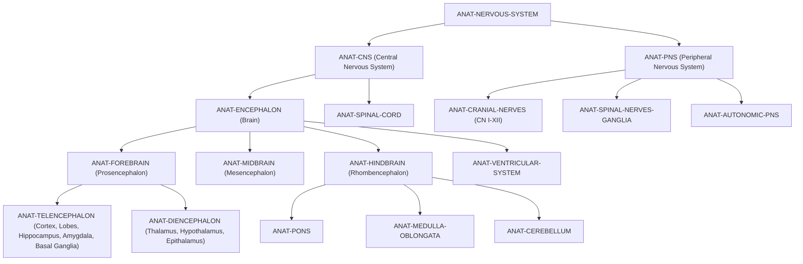

# Anatomical Hierarchy and Atlas Provenance — CORTEXIA

**Document ID:** `DOC-ANAT-002`  
**Module:** `MOD-02`  
**Status:** Authoritative (Phase 0)  
**Last Updated:** 2026-11-16

---

## 1. Purpose and Scope

This document defines the strict hierarchical tree taxonomy, coordinate reference frames, atlas provenance tiers, and mesh-simplification disclosures governing CORTEXIA's anatomical data and 3D assets.

## 2. Hierarchical Anatomical Tree

## 3. Atlas Provenance & Parcellation Standards

Every anatomical entity and 3D anatomical asset MUST record its atlas provenance and geometric fidelity tier:

| Atlas / Standard | Scope | Coordinate Space | License / Terms Summary |
|---|---|---|---|
| **FIPAT Terminologia Neuroanatomica (TNA)** | Authoritative human neuroanatomical terminology | N/A (nomenclature) | Scholarly citation attribution |
| **Desikan–Killiany (`REF-DESIKAN-2006`)** | 34 gyral cortical ROIs per hemisphere (68 cortical + subcortical FreeSurfer labels) | `MNI152 / fsaverage` | FreeSurfer open license + publication citation |
| **Destrieux (`REF-DESTRIEUX-2010`)** | 74 gyral + sulcal parcellations per hemisphere | `MNI152 / fsaverage` | FreeSurfer open license + publication citation |
| **HCP-MMP1.0 (`REF-GLASSER-2016`)** | 180 multimodal cortical areas per hemisphere | `CIFTI grayordinates` | HCP Open Access Data Use Terms + citation |
| **Julich-Brain (`REF-AMUNTS-2020`)** | 3D probabilistic cytoarchitectonic maps | `MNI Colin27 / ICBM152` | EBRAINS CC BY 4.0 + publication citation |
| **Allen Human Brain Atlas (`REF-HAWRYLYCZ-2012`)** | Anatomical reference + spatially mapped transcriptome | `MNI152` | Allen Institute non-commercial terms + same-page citation |

### 3.1 Stereotaxic Coordinate Policy
- Optional `mniCentroidMm` (`[x, y, z]`) represents approximate population-template centroid coordinates (`ICBM152 / MNI152`), NOT an individual patient's scan.
- Sub-millimeter microscopic, peripheral, or procedural structures omit `mniCentroidMm` (`null`) rather than inventing coordinates.

## 4. Provenance Classification of 3D Anatomical Meshes

| Asset Accuracy Tag | Definition | Required UI Disclosure |
|---|---|---|
| `ATLAS_SURFACE_DERIVED` | Decimated mesh derived from licensed open population MRI templates (e.g., `fsaverage` / `ICBM152`) | *"Derived from population template atlas; simplified for interactive WebGL."* |
| `SCHEMATIC_ANATOMICAL` | Artist/procedural 3D geometry guided by anatomical proportions | *"Illustrative schematic geometry; not a quantitative MRI segmentation."* |
| `CONCEPTUAL_DIAGRAM_3D` | Abstract spatial nodes/tracts visualizing topology | *"Conceptual 3D schematic."* |

## 5. Acceptance Criteria & Related Documents

- **AC-ANAT-002:** Zero anatomical structures lack a valid `parentId` (except root `ANAT-NERVOUS-SYSTEM`), `tnaName`, or `provenanceClass`.
- **Links:** [NEUROANATOMY_SPECIFICATION.md](NEUROANATOMY_SPECIFICATION.md), [ANATOMICAL_ASSET_SPECIFICATION.md](../09-visualization/ANATOMICAL_ASSET_SPECIFICATION.md).
