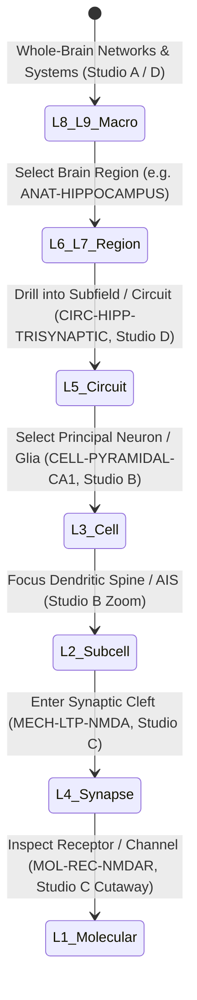

# Multi-Scale Navigation & Interactive Inspection Specification — CORTEXIA

**Document ID:** `DOC-VIS-004`  
**Module:** `MOD-01`–`MOD-10`  
**Status:** Authoritative (Phase 0)  
**Last Updated:** 2026-11-16

---

## 1. Purpose and Scope

This specification defines how users transition smoothly across CORTEXIA's **9 biological scales (`L1`–`L9`)** and **4 3D Visualization Studios**, governing camera choreography, multi-object selection, contextual labels, spatial measurement tools, animated mechanism playback, and cross-module context preservation.

## 2. Seamless Cross-Scale Transition Architecture (`L9 ↔ L1`)

### 2.1 Transition Choreography Rules
1. **Semantic Zoom Portal:** Double-clicking an anatomical subfield in Studio A or clicking **"Step Down Scale (`L7 → L3`)"** in the Scale Bar triggers a `650 ms` eased camera focal zoom (`cubic-bezier(0.22, 1, 0.36, 1)`) while pre-fetching the target Studio B/C asset chunk, cross-fading scene canvases without losing the active entity trail in the breadcrumb bar.
2. **`prefers-reduced-motion` Compliance:** When the OS/user `prefers-reduced-motion` flag is active, camera fly-tos and scale transitions execute as instant cuts (`0 ms`) with a soft `120 ms` opacity fade.

---

## 3. Selection, Highlighting & Measurement Tools

| Tool / Mode | Interaction Specification | Scientific Safeguard |
|---|---|---|
| **Single & Multi-Object Selection** | Click selects primary entity (`cyan` outline + UCES Inspector); `Shift + Click` adds up to `5` comparison entities to a pinned comparison tray | Clearly distinguishes primary inspected entity from secondary comparison targets |
| **Contextual 3D Labels** | Screen-space occluded HTML/SDF anchor pins displaying canonical name + scale badge; auto-decluttered by camera distance | Never obscure `>15%` of active mesh surface |
| **Relationship Highlighting** | Toggle modes: `Hierarchy Children`, `Structural Projections (SC)`, `Functional Co-Activation (FC)`, `Shared Neurotransmitter System` | Color-coded legend + edge provenance badge always visible |
| **Spatial Measurement Caliper** | Point-to-point Euclidean distance & along-arbor path length tool (`mm` in Studio A, `µm` in Studio B, `nm` in Studio C) | Disabled in Studio D when graph layout is topological/force-directed rather than metric |
| **Animated Mechanism Playback** | Timeline transport bar (`Play/Pause`, `Step ±1 ms`, `Speed 0.1×–2×`, `Loop`, keyframe markers) | Displays whether playback is **Live ODE Solver Driven** vs. **Curated Keyframe Schematic** |

## 4. Acceptance Criteria & Related Documents

- **AC-VIS-004:** Users can traverse `L7 → L5 → L3 → L4 → L1` and back to `L7` via the Scale Stepper or 3D portals while preserving breadcrumb history and UCES Inspector synchronization.
- **Links:** [3D_ENGINE_SPECIFICATION.md](3D_ENGINE_SPECIFICATION.md), [STUDIO_SPECIFICATIONS.md](STUDIO_SPECIFICATIONS.md), [UNIVERSAL_EXPLANATION_SYSTEM.md](UNIVERSAL_EXPLANATION_SYSTEM.md).
