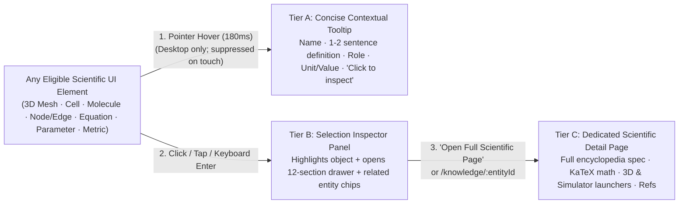

# Universal Contextual Explanation System (UCES) Specification — CORTEXIA

**Document ID:** `DOC-VIS-005`  
**Requirement Pillar:** Section 3 (`REQ-UCES-001` – `REQ-UCES-006`)  
**Applies To:** All 12 Modules (`MOD-01`–`MOD-12`) & All 5 Work Environments (`ENV-01`–`ENV-05`)  
**Status:** Authoritative (Phase 0 — Central Product Requirement)  
**Last Updated:** 2026-11-16

---

## 1. Document Purpose and Scope

This document is the authoritative architectural specification for CORTEXIA's **Universal Contextual Explanation System (UCES)**—the product-wide requirement that **every meaningful scientific element presented in the UI must be explainable, inspectable, and traceable**.

---

## 2. Three Complementary Explanation Mechanisms



### 2.1 Tier A — Hover Explanation (Concise Contextual Tooltip)
- **Trigger & Timing:** Pointer `mouseenter` / 3D BVH raycast hit sustained for `180 ms` (prevents flicker during rapid cursor movement); dismisses within `100 ms` on `mouseleave` or `Escape`.
- **Mandatory Payload (`max-width: 320px`):**
  1. **Canonical Scientific Name** + immutable ID badge (e.g., `Hippocampus · ANAT-HIPPOCAMPUS`) and Scale badge (`L7`).
  2. **Short Definition:** `1–2` crisp sentences (`60–220` characters).
  3. **Primary Function / Significance:** `1` concise clause.
  4. **Unit / Current Value** (when hovering a parameter slider, variable trace, or metric).
  5. **Action Affordance Footer:** `"Click to inspect details · Press K for full knowledge page"`.
- **Touch-Device Adaptation:** Passive hover tooltips are disabled on `@media (hover: none) and (pointer: coarse)`. A single tap on a 3D mesh shows a compact floating selection pill (`Name + "Inspect" button`) or opens the bottom-sheet Inspector directly.

### 2.2 Tier B — Click or Selection Explanation (Right-Side Contextual Inspector)
- **Trigger:** Mouse click, touch tap, tree selection, or keyboard `Enter`/`Space` on a focused scientific element.
- **Visual Synchronization:** Immediately highlights the selected object in the active 3D studio, network graph, pathway schematic, or equation card, and populates the right-side Inspector Dock (`380px` width desktop; expandable bottom sheet on tablet/mobile) with **12 mandatory sections**:
  1. **Scientific Name, Aliases & ID Badge** (`canonicalName`, `aliases`, `id`, `entityType`).
  2. **Short Definition & Overview** (`shortDefinition`, `overview`).
  3. **Biological Role & Functional Significance** (`functionalSignificance`).
  4. **Anatomical or Molecular Context** (`biologicalContext`, `anatomicalContext`, `scaleLevel`).
  5. **Detailed Physiological / Computational Mechanism** (`detailedMechanism`).
  6. **Related Structures, Cells, Molecules & Concepts** (`relationships` — clickable chips that re-target the Inspector or 3D Studio).
  7. **Governing Equations** (`equations` — rendered KaTeX cards with symbol breakdown; shown as `"Not directly governed by a standalone ODE at this scale — see linked models"` when purely anatomical).
  8. **Parameters & Physical Units** (`parameters` — default value, range, unit, provenance).
  9. **Associated Computational Models & Experiments** (`associatedModels`, `associatedExperiments` — one-click launch into `ENV-02`).
  10. **Associated 3D Visualizations & Datasets** (`associatedAssets`, `associatedDatasets`).
  11. **Verified Scientific References** (`references` — clickable `REF-*` badges with DOI/author/year).
  12. **Known Assumptions, Abstraction Level & Limitations** (`assumptions`, `limitations`, `epistemicStatus`).
- **Primary Call-to-Action:** Sticky footer button **"Open Full Scientific Knowledge Page (`/knowledge/:entityId`)"**.

### 2.3 Tier C — Dedicated Scientific Detail Page (`/knowledge/:entityId`)
- Every substantive scientific entity resolves to a full encyclopedia and technical specification page in `ENV-04` (`MOD-12`) containing comprehensive narrative, interactive 3D preview, equation derivation cards, parameter tables, simulator preset launchers, local Knowledge Graph explorer, and full bibliography (see [SCIENTIFIC_KNOWLEDGE_LIBRARY.md](../10-knowledge-architecture/SCIENTIFIC_KNOWLEDGE_LIBRARY.md)).

---

## 3. Formal Coverage Matrix by UI Entity Class

| # | UI Entity Class | Hover Tooltip (Tier A) | Click Inspector (Tier B) | Dedicated Page (Tier C) | Contextual Adaptation Rule |
|---|---|---|---|---|---|
| 1 | **3D brain structures** (`ANAT-*`) | Yes | Yes | Yes | Full 3-tier path |
| 2 | **Anatomical subregions** (`ANAT-*`) | Yes | Yes | Yes | Full 3-tier path |
| 3 | **Neuron components** (`CELL-*`) | Yes | Yes | Yes | Full 3-tier path |
| 4 | **Glial cells** (`CELL-*`) | Yes | Yes | Yes | Full 3-tier path |
| 5 | **Synaptic components** (`MECH-*`/`MOL-*`) | Yes | Yes | Yes | Full 3-tier path |
| 6 | **Molecular entities** (`MOL-*`) | Yes | Yes | Yes | Full 3-tier path |
| 7 | **Neurotransmitters** (`MOL-NT-*`) | Yes | Yes | Yes | Full 3-tier path |
| 8 | **Neural pathways** (`CIRC-*`) | Yes | Yes | Yes | Full 3-tier path |
| 9 | **Network nodes** (`ANAT-*`/`CELL-*`) | Yes | Yes | Yes | Resolves to underlying region or neuron-class page |
| 10 | **Network edges** (`CIRC-*`/Synapse) | Yes | Yes | Yes | Resolves to pathway or synaptic mechanism page |
| 11 | **Simulator variables** ($V, m, h, n, w$) | Yes | Yes | Yes | Links variable inspector to governing model/channel page |
| 12 | **Simulator parameters** (`PARAM-*`) | Yes | Yes | Yes | Links parameter inspector to `/knowledge/:paramOrModelId` |
| 13 | **Scientific equations** (`EQ-*`) | Contextual | Yes | Yes | Symbol-level hover; click opens equation inspector & `/knowledge/equations/:eqId` |
| 14 | **Chart series** ($V(t), I_{\text{Na}}(t), \text{PSD}$) | Yes | Yes | Contextual | Hover shows point + variable meaning; click inspects underlying variable/metric & links to model/method page |
| 15 | **Analysis metrics** (`ANALYTIC-*`) | Yes | Yes | Yes | Full 3-tier path for all 26 analysis methods |
| 16 | **Dataset fields** (`DSET-*` channels) | Yes | Yes | Contextual | Hover/click inspects field unit & provenance; links to parent dataset page `/knowledge/datasets/:dsetId` |
| 17 | **Scientific concepts** (`SYS-*`/`COG-*`) | Yes | Yes | Yes | Full 3-tier path |

---

## 4. Standardized Data Contract (`schemas/explanations/scientific-explanation.schema.json`)

```ts
export type EpistemicStatus =
  | 'ESTABLISHED'
  | 'ACTIVE_RESEARCH'
  | 'THEORETICAL_MODEL'
  | 'SYNTHETIC_ILLUSTRATIVE';

export type ExplanationCompleteness = 'COMPLETE' | 'PARTIAL_REVIEW' | 'INCOMPLETE';

export interface ScientificRelationshipRef {
  relationType:
    | 'CONTAINS'
    | 'PART_OF'
    | 'ANATOMICAL_CONNECTION'
    | 'FUNCTIONALLY_ASSOCIATED_WITH'
    | 'EXPRESSES'
    | 'RELEASES'
    | 'BINDS_TO'
    | 'MODULATES'
    | 'PARTICIPATES_IN'
    | 'MODELED_BY'
    | 'GOVERNED_BY_EQUATION'
    | 'PARAMETERIZED_BY'
    | 'VISUALIZED_BY'
    | 'EVALUATED_BY_EXPERIMENT'
    | 'EXPERIMENTALLY_SUPPORTED_BY'
    | 'DOCUMENTED_BY';
  targetId: string;
  note?: string;
}

export interface ScientificEntityDocumentation {
  id: string;
  canonicalName: string;
  aliases: string[];
  entityType: string;
  scientificDomain: string;
  primaryScale: 'L1' | 'L2' | 'L3' | 'L4' | 'L5' | 'L6' | 'L7' | 'L8' | 'L9';
  secondaryScales?: string[];
  abstractionLevel: string;
  epistemicStatus: EpistemicStatus;
  shortDefinition: string;          // 60 - 260 chars for Hover Tooltip
  overview: string;                 // Executive paragraph
  biologicalContext: string;
  anatomicalContext?: string;
  detailedMechanism: string;        // Substantive mechanistic explanation
  functionalSignificance: string;
  components?: string[];
  relationships: ScientificRelationshipRef[];
  equations?: string[];             // EQ-* IDs
  parameters?: string[];            // PARAM-* IDs
  associatedModels?: string[];      // MODEL-* IDs
  associatedExperiments?: string[]; // EXP-* IDs
  associatedDatasets?: string[];    // DSET-* IDs
  associatedAssets?: string[];      // ASSET-* IDs
  assumptions: string[];
  limitations: string[];
  references: string[];             // REF-* IDs (minItems: 1)
  dedicatedPageRoute: string;       // e.g. "/knowledge/ANAT-HIPPOCAMPUS"
  explanationCompleteness: ExplanationCompleteness;
}
```

---

## 5. Interaction, Accessibility, Loading & Error States

1. **Keyboard Navigation:** All interactive entities in trees, SVG diagrams, parameter controls, and 3D object lists are keyboard-focusable (`Tab`/`Arrow` keys); `Enter` opens the Inspector; `K` navigates to the Dedicated Page; `Escape` closes popovers or returns focus to the triggering element.
2. **Selection Persistence:** URL query parameter `?inspect=<entityId>` persists the active Inspector state across page reloads and shareable links.
3. **Loading, Empty & Missing-Content States:**
   - *Empty Selection:* When no specific entity is selected, the Inspector displays the active Module/Studio overview card and quick-pick suggested entities.
   - *Missing / Incomplete Entity Guardrail:* Never fabricate or substitute generic text. If an entity lookup fails or has `explanationCompleteness !== "COMPLETE"`, display a structured diagnostic banner (`ERR_EXPLANATION_INCOMPLETE`) showing the entity ID and reporting the gap.

---

## 6. Ten Mandatory Acceptance Criteria (`AC-UCES-001` – `AC-UCES-010`)

1. **`AC-UCES-001`:** Every eligible 3D object in Studios A–D carries a stable entity ID (`ANAT-*`, `CELL-*`, `MOL-*`, `MECH-*`, `CIRC-*`).
2. **`AC-UCES-002`:** Selecting any object deterministically resolves the exact matching `ScientificEntityDocumentation` record.
3. **`AC-UCES-003`:** The Inspector displays entity-specific biological, mechanistic, and mathematical content across all 12 fields.
4. **`AC-UCES-004`:** The Inspector provides a working deep link to `/knowledge/:entityId`.
5. **`AC-UCES-005`:** Related entities in the Inspector (`relationships`) can be clicked to inspect or navigate directly.
6. **`AC-UCES-006`:** Equations (`EQ-*`) and parameters (`PARAM-*`) link bidirectionally to their governing model definitions (`MODEL-*`).
7. **`AC-UCES-007`:** Verified scientific references (`REF-*`) are accessible from both the Inspector and Dedicated Page.
8. **`AC-UCES-008`:** Zero selected objects silently display unrelated or generic filler descriptions.
9. **`AC-UCES-009`:** Any missing content is explicitly flagged by both the UI state and the automated coverage audit rather than fabricated.
10. **`AC-UCES-010`:** Hover, click-inspector, keyboard, and touch interactions pass desktop and mobile E2E verification.

---

## 7. Automated Explanation Completeness Audit Specification

`tools/documentation-audit/run_audit.py` enforces 10 automated UCES checks across `registries/explanation-coverage/explanation-coverage.json` and all domain registries:
1. Entities missing `shortDefinition` (`< 40` chars).
2. Entities missing `detailedMechanism` (`< 80` chars).
3. Entities with empty `references` (`len == 0`) or broken `REF-*` pointers.
4. Models (`MODEL-*`) missing `equations` or `parameters`.
5. 3D assets (`ASSET-*`) with unmapped or non-existent `mappedEntityIds`.
6. Explanation records missing valid `dedicatedPageRoute`.
7. Orphaned explanation records not linked in the Knowledge Graph.
8. Broken cross-references in `relationships`, `equations`, `parameters`, `associatedModels`, `associatedExperiments`, or `associatedDatasets`.
9. Duplicate entity IDs across registries.
10. Entities with `explanationCompleteness != "COMPLETE"`.

## 8. Related Documents

- [PRODUCT_REQUIREMENTS.md](../01-product/PRODUCT_REQUIREMENTS.md)
- [STUDIO_SPECIFICATIONS.md](STUDIO_SPECIFICATIONS.md)
- [KNOWLEDGE_GRAPH_SPECIFICATION.md](../10-knowledge-architecture/KNOWLEDGE_GRAPH_SPECIFICATION.md)
- [MODULE_UX_SPECIFICATIONS.md](../13-ui-ux/MODULE_UX_SPECIFICATIONS.md)
