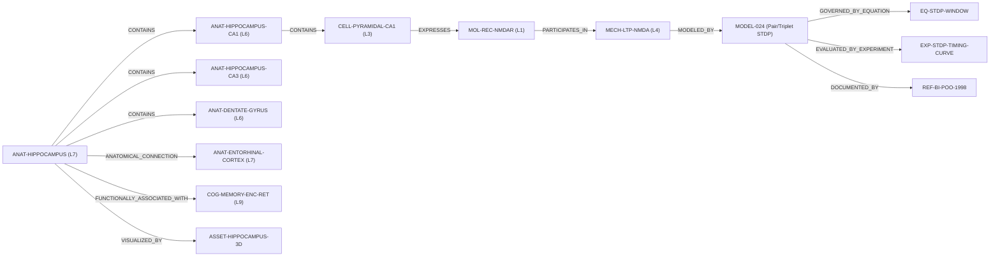

# Scientific Knowledge Graph Specification — CORTEXIA

**Document ID:** `DOC-KG-001`  
**Module:** `MOD-12` (Scientific Knowledge & Research Library)  
**Status:** Authoritative (Phase 0)  
**Last Updated:** 2026-11-16

---

## 1. Purpose and Scope

This document defines the typed ontology, node categories, directional edge vocabulary, referential integrity invariants, traversal algorithms, and UI integration of CORTEXIA's **Scientific Knowledge Graph**, which serves as the connective spine across all 12 modules and 9 biological scales.

## 2. Twenty Typed Entity Node Categories

Every node in `registries/knowledge-graph/knowledge-graph.json` (`schemas/knowledge-graph/kg-node.schema.json`) belongs to one of 20 strict `nodeCategory` enumerations:

| # | Node Category Enum | ID Prefix | Primary Registry |
|---|---|---|---|
| 1 | `ANATOMICAL_STRUCTURE` | `ANAT-` | `anatomical-entities.json` |
| 2 | `CELL_TYPE` | `CELL-` | `cellular-entities.json` |
| 3 | `CELLULAR_COMPONENT` | `CELL-COMP-` / `MOL-` | `cellular-entities.json` |
| 4 | `MOLECULE` | `MOL-` | `molecular-entities.json` |
| 5 | `NEUROTRANSMITTER` | `MOL-NT-` | `molecular-entities.json` |
| 6 | `RECEPTOR` | `MOL-REC-` | `molecular-entities.json` |
| 7 | `ION_CHANNEL` | `MOL-CH-` | `molecular-entities.json` |
| 8 | `PHYSIOLOGICAL_MECHANISM` | `MECH-` | `physiological-mechanisms.json` |
| 9 | `NEURAL_PATHWAY` | `CIRC-PATH-` | `circuits-and-pathways.json` |
| 10 | `NEURAL_CIRCUIT` | `CIRC-` | `circuits-and-pathways.json` |
| 11 | `BRAIN_NETWORK` | `CIRC-NET-` | `circuits-and-pathways.json` |
| 12 | `FUNCTIONAL_SYSTEM` | `SYS-` | `functional-systems.json` |
| 13 | `COGNITIVE_CONCEPT` | `COG-` | `explanation-coverage.json` |
| 14 | `MATHEMATICAL_MODEL` | `MODEL-` | `scientific-models.json` |
| 15 | `EQUATION` | `EQ-` | `equations.json` |
| 16 | `PARAMETER` | `PARAM-` | `parameters.json` |
| 17 | `EXPERIMENT` | `EXP-` | `experiments.json` |
| 18 | `DATASET` | `DSET-` | `datasets.json` |
| 19 | `SCIENTIFIC_REFERENCE` | `REF-` | `scientific-references.json` |
| 20 | `ASSET_3D` | `ASSET-` | `assets-3d.json` |

---

## 3. Typed Semantic Relationship Vocabulary

Relationships (`schemas/knowledge-graph/kg-edge.schema.json`) are strictly typed and directional (`sourceId --[relationType]--> targetId`). Conflating structural, functional, and modeling edges is forbidden:

| Relation Type Enum | Domain → Range | Semantic Meaning |
|---|---|---|
| `CONTAINS` | `ANAT` → `ANAT` / `CELL` | Spatial or hierarchical anatomical inclusion (inverse of `PART_OF`) |
| `PART_OF` | `ANAT` / `CELL` / `MOL` → `ANAT` / `SYS` | Meronymic membership in a parent structure or system |
| `ANATOMICAL_CONNECTION` | `ANAT` / `CELL` → `ANAT` / `CELL` | Physical axonal projection or synaptic contact |
| `FUNCTIONALLY_ASSOCIATED_WITH` | `ANAT` / `CIRC` → `SYS` / `COG` | Empirical involvement in a distributed functional/cognitive process |
| `EXPRESSES` | `CELL` / `ANAT` → `MOL` | Transcriptomic or proteomic expression of channel/receptor/protein |
| `RELEASES` | `CELL` / `ANAT` → `MOL-NT` | Presynaptic vesicular or volume release of neurotransmitter |
| `BINDS_TO` | `MOL-NT` → `MOL-REC` | Ligand-receptor biochemical binding |
| `MODULATES` | `MOL` / `MECH` / `CELL` → `MECH` / `CIRC` | Biophysical or neuromodulatory regulation of gain, kinetics, or excitability |
| `PARTICIPATES_IN` | `CELL` / `MOL` / `ANAT` → `MECH` / `CIRC` | Active participation in a physiological mechanism or circuit motif |
| `MODELED_BY` | `ANAT` / `CELL` / `MECH` / `CIRC` → `MODEL` | Quantitative representation by a computational model (with explicit abstraction note) |
| `GOVERNED_BY_EQUATION` | `MODEL` / `MECH` / `ANALYTIC` → `EQ` | Mathematical formulation governing the model or mechanism |
| `PARAMETERIZED_BY` | `MODEL` / `EQ` → `PARAM` | Dependence on a typed physical parameter |
| `VISUALIZED_BY` | Any Entity → `ASSET` | 3D mesh/scene representation in Studios A–D |
| `EVALUATED_BY_EXPERIMENT` | `MODEL` / `MECH` → `EXP` | Interactive computational experiment probing the entity |
| `EXPERIMENTALLY_SUPPORTED_BY` | Any Entity → `DSET` | Empirical grounding in a curated dataset |
| `DOCUMENTED_BY` | Any Entity → `REF` | Bibliographic provenance in peer-reviewed literature |

---

## 4. Canonical Subgraph Example (Hippocampus Multi-Scale Spine)

---

## 5. Graph Integrity Invariants & Query Engine

1. **Zero Orphan Rule:** Every node in `knowledge-graph.json` MUST have total degree $\text{deg}(v) = \text{deg}_{\text{in}}(v) + \text{deg}_{\text{out}}(v) \ge 1$.
2. **Dangling Endpoint Prevention:** Every `sourceId` and `targetId` in `edges` MUST resolve to a registered node ID.
3. **Client-Side Graph Traversal:** Supports 1-hop and 2-hop ego-network extraction, shortest semantic path (`BFS`) between any two entities (e.g., `"How does MOL-CH-NAV1-6 relate to COG-WORKING-MEMORY?"`), and scale-filtered projection (`L1`–`L9`).

## 6. Acceptance Criteria & Related Documents

- **AC-KG-001:** `tools/documentation-audit/run_audit.py` verifies 0 orphaned nodes, 0 dangling edges, and 100% valid relation enums across `knowledge-graph.json`.
- **Links:** [SCIENTIFIC_KNOWLEDGE_LIBRARY.md](SCIENTIFIC_KNOWLEDGE_LIBRARY.md), [UNIVERSAL_EXPLANATION_SYSTEM.md](../09-visualization/UNIVERSAL_EXPLANATION_SYSTEM.md), [DATA_ARCHITECTURE.md](../11-data-and-research/DATA_ARCHITECTURE.md).
