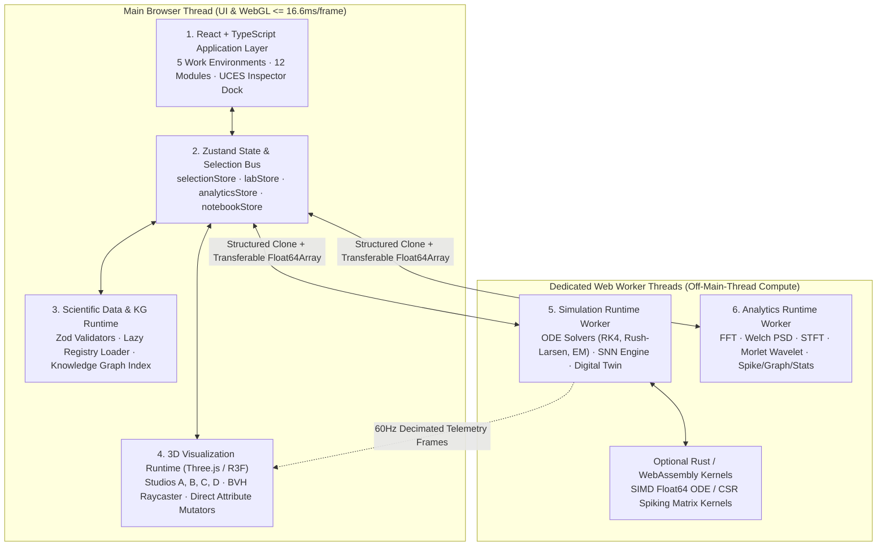
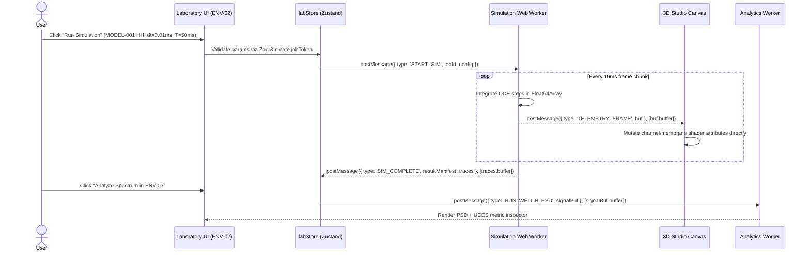

# System & Runtime Architecture — CORTEXIA

**Document ID:** `DOC-ARCH-001`  
**Status:** Authoritative (Phase 0)  
**Last Updated:** 2026-11-16

---

## 1. Purpose and Scope

This document defines CORTEXIA's end-to-end software architecture, runtime subsystem boundaries, technology stack, inter-subsystem data flow, and sequence protocols across the UI, 3D Visualization, Scientific Data, Simulation Worker, Analytics Worker, and optional Rust/WASM compute layers.

## 2. Technology Stack Baseline

| Architectural Layer | Selected Technology | Rationale & Constraints |
|---|---|---|
| **Application Framework** | `React 19 + TypeScript 5.x (strict)` | Composable workspace panels, strict compile-time contracts |
| **Build & Bundler** | `Vite` | Fast ES module chunking, native Web Worker & WASM asset bundling |
| **Client State Management** | `Zustand` (modular domain stores) | Low-overhead selector subscriptions preventing whole-tree re-renders |
| **3D Visualization** | `Three.js + @react-three/fiber + @react-three/drei + three-mesh-bvh` | Declarative scene graph + direct imperative buffer mutation for 60 fps telemetry |
| **3D Asset Format** | `glTF 2.0 / .glb` (Draco/Meshopt) + `SWC` tubular parser | Compact static delivery on GitHub Pages |
| **Scientific Plotting** | `uPlot` / `Canvas2D` (high-density time series & rasters) + `D3` / `SVG` (nullclines, heatmaps, KG) | Avoids heavy DOM overhead when rendering `100,000+` voltage/EEG samples |
| **Numerical & Signal Core** | `TypeScript (Float64Array)` in **Web Workers** | Off-main-thread execution with zero UI blocking |
| **High-Performance Kernel Option** | `Rust -> wasm32-unknown-unknown` (benchmark-gated) | Activated for dense SNNs (`N > 2,000`) or multi-channel wavelet sweeps if TS exceeds budget |
| **Schema Validation** | `JSON Schema Draft 2020-12` + `Zod` runtime validators | Guarantees static/runtime contract parity |
| **Automated QA** | `Vitest` (unit/numerical/schema) + `Playwright` (E2E browser) | Deterministic verification across solvers, schemas, and UI |
| **Static Hosting** | `GitHub Pages` (`gh-pages` / Actions artifact deployment) | Zero-backend static scientific web platform |

---

## 3. Six-Layer Runtime Architecture

---

## 4. End-to-End Execution Sequence (Simulation → 3D → Analytics)

## 5. Module Boundary Rules

1. **Strict Separation of Concerns:** React UI components (`src/features/*`) NEVER instantiate ODE loops, FFT transforms, or raw `fetch()` calls directly.
2. **Pure Numerical Kernels:** `src/kernels/models/*` and `src/kernels/analytics/*` are pure, zero-DOM TypeScript/WASM functions testable deterministically in Node/Vitest without a browser.
3. **Single Registry Resolver:** All entity lookups pass through `src/data/registryResolver.ts` backed by validated JSON registries.

## 6. Acceptance Criteria & Related Documents

- **AC-ARCH-001:** Main-thread tasks never exceed `16 ms` during active simulation or signal processing; all numerical kernels execute in workers and pass isolated Vitest suites.
- **Links:** [FRONTEND_ARCHITECTURE.md](FRONTEND_ARCHITECTURE.md), [SIMULATION_AND_WORKER_ARCHITECTURE.md](SIMULATION_AND_WORKER_ARCHITECTURE.md), [PERFORMANCE_ARCHITECTURE.md](PERFORMANCE_ARCHITECTURE.md).
