# CI/CD Pipeline & Release Process — CORTEXIA

**Document ID:** `DOC-DEP-003`  
**Status:** Authoritative (Phase 0)  
**Last Updated:** 2026-11-16

---

## 1. Purpose and Scope

This document defines the continuous integration, automated quality-gate pipeline, semantic versioning scheme, and GitHub Pages continuous deployment workflow for CORTEXIA.

## 2. GitHub Actions CI/CD Workflow Specification (`.github/workflows/ci-deploy.yml`)

```mermaid
flowchart LR
  Push["Push / PR to main"] --> Gate0["Job 1: Doc & Schema Audit\npython3 tools/documentation-audit/run_audit.py"]
  Gate0 --> Gate1["Job 2: Typecheck, Lint & Unit/Solver QA\ntsc --noEmit · eslint · vitest run"]
  Gate1 --> Gate2["Job 3: Production Build & Bundle Budget Check\nvite build · verify chunk sizes & 404.html"]
  Gate2 --> Gate3["Job 4: Playwright E2E, 3D & Accessibility QA\nplaywright test (Desktop + Mobile + axe)"]
  Gate3 -->|"main branch only"| Deploy["Job 5: Deploy to GitHub Pages\nactions/upload-pages-artifact + deploy-pages"]
  Deploy --> Smoke["Job 6: Live Production Smoke Verification\nPlaywright against live GitHub Pages URL"]
```

### 2.1 Non-Bypassable Quality Gates
- **Gate 0 (`doc-schema-audit`):** Fails immediately if any Markdown link is broken, any JSON Schema validation fails, any registry foreign key is dangling, or UCES explanation coverage drops below 100% of registered entities.
- **Gate 1 (`unit-numerical-qa`):** Executes all `VAL-*` solver and model verification tests in Vitest.
- **Gate 2 (`build-budget`):** Verifies clean Vite build, presence of `.nojekyll` and `404.html`, and bundle size budgets.
- **Gate 3 (`e2e-playwright`):** Verifies all 5 environments, 12 modules, 4 3D studios, UCES 3-tier flows, and WCAG 2.1 AA compliance.

---

## 3. Release Versioning & Change Control

- **Semantic Versioning (`MAJOR.MINOR.PATCH`):**
  - `0.1.0-phase0`: Authoritative Phase 0 Specification Baseline.
  - `0.2.0` – `0.8.0`: Incremental milestone releases for Implementation Phases A through G.
  - `1.0.0`: Phase H audited production release on GitHub Pages.
- **Specification-First Rule:** Every feature PR in Phases A–H must keep `docs/`, `schemas/`, and `registries/` synchronized with `src/` and pass `run_audit.py`.

## 4. Acceptance Criteria & Related Documents

- **AC-DEP-003:** CI/CD workflow enforces all 6 sequential jobs before declaring a release green.
- **Links:** [BUILD_CONFIGURATION.md](BUILD_CONFIGURATION.md), [GITHUB_PAGES_DEPLOYMENT.md](GITHUB_PAGES_DEPLOYMENT.md), [IMPLEMENTATION_ROADMAP.md](../16-project-management/IMPLEMENTATION_ROADMAP.md).
