# Flagship Implementation Roadmap (Phases A–H) — CORTEXIA

**Document ID:** `DOC-PM-001`  
**Status:** Authoritative (Phase 0)  
**Last Updated:** 2026-11-16

---

## 1. Purpose and Scope

This document defines the staged implementation roadmap (`Phase A` through `Phase H`) following Phase 0 completion, specifying objectives, deliverables, dependencies, technical tasks, scientific tasks, risks, testing gates, and completion conditions for each phase.

## 2. Roadmap Sequence Dependency Graph

```mermaid
flowchart LR
  P0["Phase 0\nSpecification & Audit\n(COMPLETE)"] --> PA["Phase A\nScientific & Platform\nFoundation"]
  PA --> PB["Phase B\nAnatomical, Cellular, Molecular\n& 3D Studios A-C"]
  PB --> PC["Phase C\nNeurophysiology &\nSynaptic Dynamics"]
  PC --> PD["Phase D\nComputational Neuroscience\nLaboratory Core"]
  PD --> PE["Phase E\nConnectomics, Systems &\nCognitive Neuroscience"]
  PE --> PF["Phase F\nNeural Signal Analytics &\nResearch Infrastructure"]
  PF --> PG["Phase G\nIntegrated Digital Twin &\nFull Knowledge Graph"]
  PG --> PH["Phase H\nScientific Audit, Browser QA\n& GitHub Pages Delivery"]
```

---

## 3. Phase-by-Phase Specification (`Phases A – H`)

### Phase A — Scientific & Platform Foundation
- **Objectives:** Establish Vite + React + TypeScript + Zustand shell, Design System (`DOC-UX-001`), 5 Work Environments navigation, Zod runtime registry loaders, Knowledge Graph index, **Universal Contextual Explanation System (UCES)** (Hover, 12-field Inspector, `/knowledge/:entityId` pages), and `MOD-01` Observatory.
- **Dependencies:** Phase 0 (`DOC-*`, `schemas/*`, `registries/*`).
- **Testing & Completion Gate:** All routes mount cleanly; UCES Tier A/B/C E2E tests pass; global search (`Cmd/Ctrl + K`) resolves all registry entities in `< 25 ms`.

### Phase B — Anatomical & Biological Foundation
- **Objectives:** Deliver `MOD-02` Neuroanatomy Atlas, `MOD-03` Cellular Neuroscience, `MOD-04` Molecular Systems (static/structural views), `MOD-05` Synaptic Architecture, and Three.js/R3F **Studios A, B, and C** with BVH raycasting, orthogonal clipping planes, isolation mode, SWC morphology loader, and asset provenance badges.
- **Dependencies:** Phase A shell & UCES.
- **Testing & Completion Gate:** 100% of Studio A–C meshes resolve valid entity IDs on hover/click; 60 fps orbit verified (`BM-002`, `BM-003`).

### Phase C — Neural Physiology & Dynamics
- **Objectives:** Deliver `MOD-07` Neurophysiology explorers, interactive Nernst & Goldman–Hodgkin–Katz equilibrium calculators (`MOD-04`), action potential stage scrubber, dendritic passive cable explorer, and animated vesicle/receptor gating playback in Studio C.
- **Dependencies:** Phase B cellular/molecular studios.
- **Testing & Completion Gate:** Nernst/GHK unit tests pass; Studio C step-by-step synaptic transmission playback synchronizes with UCES Inspector.

### Phase D — Computational Neuroscience Core (`MOD-08`)
- **Objectives:** Implement `SimulationWorker`, all 8 numerical solvers (`RK4`, `Rush–Larsen`, `Euler–Maruyama`, `HybridSpike`, etc.), the 5-Panel Standard Simulation Workspace, and models `MODEL-001` through `MODEL-026` (single-neuron, synaptic, STP, population, SNN, plasticity, TD-RL).
- **Dependencies:** Phase C physiology foundations.
- **Testing & Completion Gate:** All `VAL-HH-001` through `VAL-TDRL-001` benchmarks and step-convergence order tests pass in Vitest; worker cancellation `< 15 ms`.

### Phase E — Neural Networks & Brain Systems (`MOD-06`, `MOD-09`, `MOD-10`)
- **Objectives:** Deliver **Studio D Neural Network Studio**, `MOD-06` Connectomics workbench (SC/FC/Synthetic provenance badges + graph topology metrics + `MODEL-027`/`028`), `MOD-09` 12 Functional Brain Systems pathway explorers, and `MOD-10` Cognitive Neuroscience distributed network & consciousness theory explorers.
- **Dependencies:** Phase B Studio A + Phase D network solvers.
- **Testing & Completion Gate:** `VAL-KURAMOTO-001` and `VAL-GRAPH-001` pass; SC/FC/Synthetic badges and anti-localization disclaimers verified across all views.

### Phase F — Data, Signal Analytics & Research Infrastructure (`MOD-11`, `ENV-05`)
- **Objectives:** Implement `AnalyticsWorker` and all 26 analysis methods (`MOD-11`: FIR/IIR filters, FFT, Welch PSD, STFT, Morlet wavelet, ERP, spike rasters/ISI/PSTH/STA/CCG, graph metrics, bootstrap/FDR/regression stats), local CSV/SWC importer, Dataset Catalog viewer, Parameter Sweeps, Multi-Run Comparison, and Research Notebook (`.cortexia.json` export/import).
- **Dependencies:** Phase D simulation outputs + Phase E graph metrics.
- **Testing & Completion Gate:** All 26 analytics methods pass synthetic ground-truth tests; deterministic seed replay verified (`AC-DATA-004`).

### Phase G — Integrated Brain Systems & Digital Twin (`Tier 5`, `MOD-12`)
- **Objectives:** Implement the **5-Tier Educational Digital Twin** pipeline (`EXP-TWIN-EXCITABILITY-TO-CIRCUIT`, `EXP-TWIN-PLASTICITY-TO-DYNAMICS`, `EXP-TWIN-CONNECTOME-OSCILLATIONS`), simulation-linked 3D shader playback across Studios B–D, and full interactive Knowledge Graph path-finder (`MOD-12`).
- **Dependencies:** Phases B–F.
- **Testing & Completion Gate:** All 3 integrated cross-scale experiments execute end-to-end within memory budgets and display mechanistic-vs-conceptual coupling badges.

### Phase H — Scientific Audit, Browser QA & GitHub Pages Delivery
- **Objectives:** Execute full Levels 1–4 Scientific & Numerical QA, `BM-001`–`BM-010` performance benchmarks (activating optional Rust/WASM kernels if any TS kernel misses target), Playwright desktop/mobile/accessibility suite, GitHub Pages deployment, and live production URL verification.
- **Dependencies:** Phases A–G complete.
- **Testing & Completion Gate:** All `AC-IMP-*` and `AC-IMP-DEPLOY` checks pass on live `https://orls967.github.io/Cortexia/`.

## 4. Related Documents

- [TASK_BREAKDOWN.md](TASK_BREAKDOWN.md)
- [RISKS_AND_MITIGATIONS.md](RISKS_AND_MITIGATIONS.md)
- [PROGRESS_TRACKER.md](PROGRESS_TRACKER.md)
